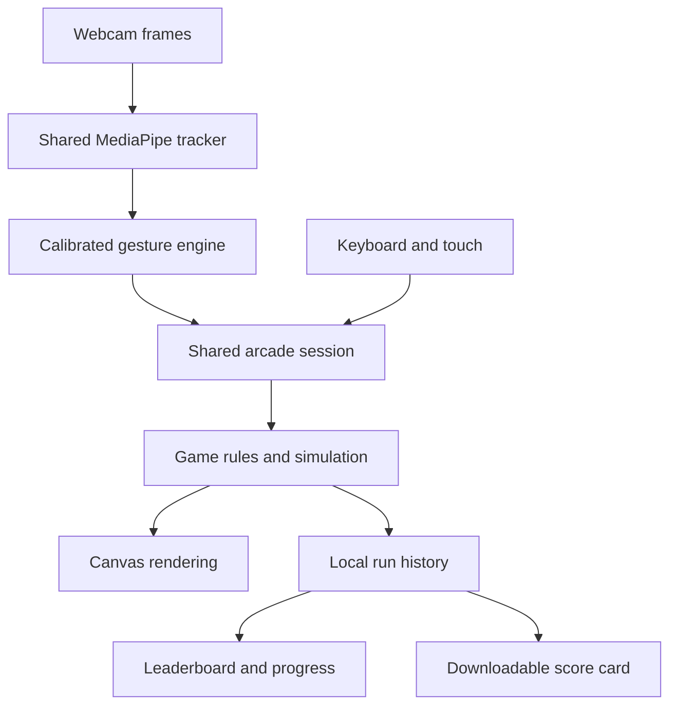

# FaceControl

**Your Face. Your Controller.** FaceControl is a browser arcade with three original games. Play with facial gestures, a keyboard, or on-screen touch controls.

## Problem

Arcade games usually expect a keyboard, controller, or touch input. FaceControl explores whether an ordinary webcam can offer a hands-free way to play without sending camera footage to a server. Calibration helps the player find gestures that feel comfortable. Manual controls let anyone try the games while the camera is off.

## Games and controls

| Game | Webcam controls | Keyboard and touch | Game rules |
| --- | --- | --- | --- |
| **Blink Runner** | Deliberately blink to jump. | Space or **Jump**. | A side-scrolling runner. Jump over barriers with gravity and a single jump per landing. Score grows with survival time and barriers cleared. |
| **Face Racer** | Tilt once to change lanes. Return upright before the next tilt. | Left/right arrows, A/D, or **Left** and **Right**. | Dodge faster traffic on a three-lane road, collect coins, and use a shield that absorbs one hit before it expires. |
| **SpaceFace** | Hold a tilt to steer. Open your mouth to fire. Smile to blast at full charge. | Hold arrows or A/D to steer, hold Space to fire, and press E for blast. Hold the matching touch buttons. | Survive asteroid waves with three lives. Shoot or dodge asteroids, collect health or shields, and charge a blast that clears nearby hazards. |

Other features include guided onboarding, a mirrored preview with optional landmark mesh, per-game sensitivity, a three-second countdown, pause and deliberate resume, fullscreen on supported browsers, optional generated sound, and Reduce Motion. The Progress page includes personal records, achievements, and a daily challenge. The Leaderboard filters completed runs by game and lets players download PNG score cards.

## Technology

- **React and Vite** for the interface, development server, and production build.
- **JavaScript, Canvas 2D, and CSS** for game simulation, artwork, and responsive layouts.
- **MediaPipe Tasks Vision** with WebAssembly for on-device facial landmarks and expression scores.
- **Web Audio, LocalStorage, and Node’s test runner** for sound, local progress, and automated tests. No account, backend, or paid API is required.

## Architecture



The React app owns hash-based navigation, the in-memory calibration profile, and preferences. The shared arcade screen owns the countdown, game loop, pointer and keyboard input, and score saving. Each game has its own rules in `src/runner/engine.js`, `src/racer/engine.js`, or `src/space/engine.js`. Rendering is separate in each game’s `render.js`. Each engine advances by elapsed time in small simulation steps to keep interactions and collisions consistent across frame rates.

### How facial recognition works

1. When the player explicitly starts the camera, the browser requests video permission. MediaPipe identifies face landmarks and estimates signals such as eye closure, jaw opening, and smiling.
2. Calibration samples a relaxed face and practice gestures. The engine uses those samples to choose a neutral angle and personal detection thresholds. A sensitivity setting adjusts how much movement is needed.
3. Smoothing reduces noise. The engine requires a gesture to cross a threshold for long enough to count, uses a lower threshold to detect release, and applies a cooldown to limit duplicates. Blink Runner uses deliberate bilateral blinks. Face Racer requires a return to neutral before another lane change. SpaceFace reads steering and firing as held signals and spends a blast only on a new smile.
4. Losing face tracking pauses a camera-controlled game. The game waits for the player to select Resume. Leaving the page stops webcam tracks, cancels animation callbacks, and closes the detector.

## Run locally

Install Node.js 22.12 or newer. In a terminal opened to the project folder, run the following commands.

```powershell
npm ci
npm run dev
```

Open [http://localhost:5173](http://localhost:5173). On Windows PowerShell, use `npm.cmd` if execution policy blocks `npm.ps1`.

The optional model command puts the public MediaPipe model in `public/models/face_landmarker.task`. The app checks that local path before falling back to Google’s public model URL. After a successful local model download, normal gameplay can run against a local server without reaching Google.

```powershell
npm run model:download
npm test
npm run build
npm run preview
```

## Privacy and local records

Camera permission is optional. FaceControl never uploads or stores webcam video, images, or landmark data. Calibration is held in the current tab and cleared when the page is refreshed or closed. The only camera-related network request is for the public model if it is missing from the site. The model and WebAssembly code process the camera stream in the browser. [MediaPipe Face Landmarker documentation](https://developers.google.com/edge/mediapipe/solutions/vision/face_landmarker)

LocalStorage holds gameplay results, recorded active playtime, challenge attempts, preferences, and onboarding state. Achievements are calculated from the saved gameplay data. Completed runs enter the Leaderboard. Abandoned runs count toward personal statistics and playtime only. Countdown and paused time are excluded. Legacy scores are preserved, although they have no recorded playtime. A PNG score card contains only game data and is exported when requested.

The daily challenge rotates at midnight UTC. The date determines one game, a score target, and a repeatable random seed. Restarting a daily attempt resets that seed. A run that starts before midnight keeps its original challenge until it ends.

## Testing

Phase 6 passed **48 automated tests**, including the 39 existing game and tracking tests and 9 additional checks for progress, storage recovery, score-card content, input cleanup, and camera disposal. The production build passed with both root and repository-subpath asset paths.

In a local browser, the guide stayed dismissed after reload and reopened from Settings. Fullscreen entered and exited successfully. Blink Runner cleared a barrier with both the keyboard and on-screen button. A daily run appeared in Progress and on the Leaderboard, the First Run achievement unlocked, and abandoned runs were counted separately. The game library and SpaceFace fit a simulated 390-pixel viewport. Score-card generation passed checks, and saving the PNG to disk remains a manual check.

| Manual check | Expected result |
| --- | --- |
| Open a fresh browser profile, dismiss the guide, reload, then open it again in Settings. | The walkthrough appears once and can be reopened. It never starts the camera. |
| Recheck calibration and all three games with a webcam. Deny permission once, then allow it and revisit a game. | Manual controls are available if permission is denied. Gestures match the game instructions. Exiting turns off the camera even if startup is still pending. |
| Hold two touch buttons in SpaceFace and use keyboard controls in all games. | Touch inputs can overlap, and controls release on cancellation, focus loss, or pause. |
| Enter and exit fullscreen and test Reduce Motion on a phone and desktop. | Controls stay reachable and the game remains readable. |
| Finish a normal run, abandon an active run, and play a daily challenge. Reload and download a score card. | Progress reflects all runs, the Leaderboard uses completed runs, and the PNG contains only score information. |

Phase 7 passed **58 automated tests**, including 10 new checks for selfie-camera preferences, performance adjustment, background pauses, overlapping touch controls, model loading, and the PWA manifest and service worker. The production build passed both at `/` and under a sample repository path.

In the desktop browser’s simulated 390 × 844 and 844 × 390 viewports, all three games fit horizontally and their gameplay controls stayed on screen. The compact preview opened and closed. The background check used simulated browser visibility events. Actual camera selection, app switching, installation, and two-finger input remain physical-device checks.

## Phones and installation

- The browser is asked for the front-facing camera and may fall back to another camera if a selfie camera is unavailable. The capture is resized when needed and slow devices process fewer frames. Closing the in-game preview hides the picture, while gestures and detection status remain active.
- The games work in portrait and landscape. Their automatic graphics setting adjusts canvas resolution, draw rate, and decorative effects. Game physics, scores, and saved preferences follow the same rules at every graphics level. Holding **Left** or **Right** with **Fire** uses two simultaneous controls in SpaceFace.
- Changing tabs or switching apps pauses play. Come back and press **Resume**. If your phone interrupted the camera, enable it again or switch to keyboard/touch. Reduce Motion stays in effect.
- From the hosted HTTPS site, open Chrome’s menu on Android and choose **Install app** or **Add to Home screen** when available. On iPhone Safari, open **Share → Add to Home Screen**, turn on **Open as Web App** when offered, and tap **Add**. The production worker shows an offline message if the site cannot load. Offline gameplay is outside the scope of this build. [Apple’s Home Screen instructions](https://support.apple.com/guide/iphone/iph42ab2f3a7/ios)
- A phone opening `http://192.168.x.x` on your Wi-Fi normally cannot use the camera. Use the hosted HTTPS address or a trusted local HTTPS setup. The quick local desktop test can use `http://localhost:5173`.

## GitHub Pages deployment

The repository includes a **manual-only** workflow at `.github/workflows/pages.yml`. It installs dependencies, runs tests, downloads the pinned public model, and builds with the base path reported by GitHub Pages. The workflow retries the model download and verifies the model again inside `dist` before uploading it. It needs access to the npm registry and `storage.googleapis.com` during the build. A successful deployment serves the model and matching WebAssembly files from the Pages site. No deployment has been published. [Vite’s GitHub Pages guide](https://vite.dev/guide/static-deploy.html#github-pages) · [GitHub Pages publishing sources](https://docs.github.com/en/pages/getting-started-with-github-pages/configuring-a-publishing-source-for-your-github-pages-site)

1. When ready to publish on GitHub Free, create an empty **public** repository named `facecontrol`. Push this project folder, including `.github/workflows/pages.yml` and `package-lock.json`. The ignored `node_modules` and `dist` folders stay local.
2. In the repository, open **Settings → Pages** and set **Source** to **GitHub Actions**.
3. In **Actions**, select **Deploy FaceControl to GitHub Pages**, choose the main branch, and click **Run workflow**. If the model step fails, check GitHub’s build log and rerun when the model host is reachable. For local testing, run `npm run model:download` or download the [pinned official model](https://storage.googleapis.com/mediapipe-models/face_landmarker/face_landmarker/float16/1/face_landmarker.task) into `public/models/face_landmarker.task`.
4. Open the HTTPS address in the deployment summary. Test Calibration and all three games, then check both orientations, two-finger controls, app switching, and the Home Screen launch on a physical Android phone and iPhone. [GitHub Pages availability and limits](https://docs.github.com/en/pages/getting-started-with-github-pages/github-pages-limits)

## Known limitations

- A compatible browser, a webcam, and reasonable lighting are needed for face controls. Fullscreen availability depends on the browser and device.
- Rankings and achievements are personal to the current browser and can be cleared or edited locally. There is no account sync or global competition.
- Active time from older runs cannot be recovered. An abrupt browser or operating system shutdown may prevent the current run from being saved.
- The hosted GitHub Pages workflow, live webcam calibration, and physical-phone multitouch still need verification. The work environment could not reach Google to download the model, although the build and asset paths passed local checks.

## Future improvements

- Offer additional gesture mappings for players who find the default controls uncomfortable.
- Collect opt-in feedback on calibration and difficulty across more devices and lighting conditions.
- Add a browser-level test suite with controlled video input and more mobile accessibility coverage.

## AI-assisted development

OpenAI Codex assisted with implementation, refactoring, tests, and documentation. The project owner directed the feature phases and performed manual webcam and gameplay checks during development. Automated tests and manual browser checks are reported separately.

## Third-party licenses

See [Third-party notices](public/THIRD-PARTY-NOTICES.txt) for React, Lucide, MediaPipe, and the Face Landmarker model. The notices and accompanying license texts are copied into the hosted build. The project has no separate license granting reuse of the original FaceControl code or assets.
